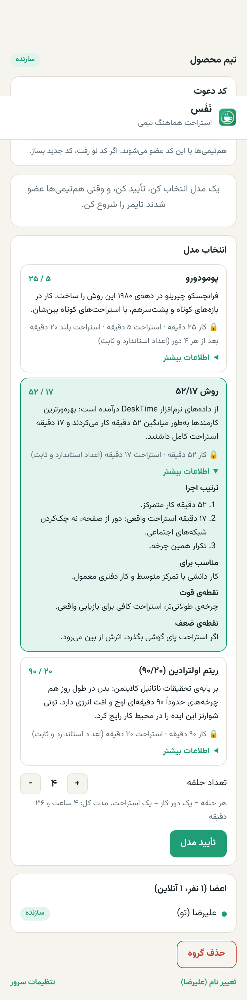
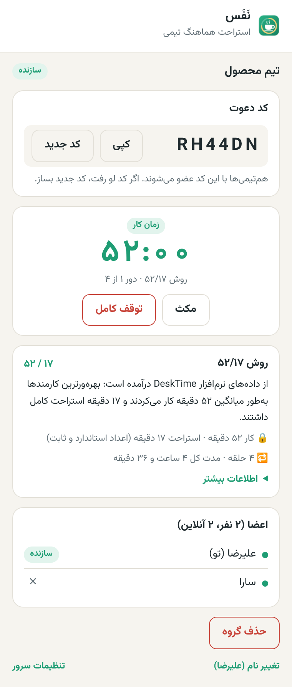
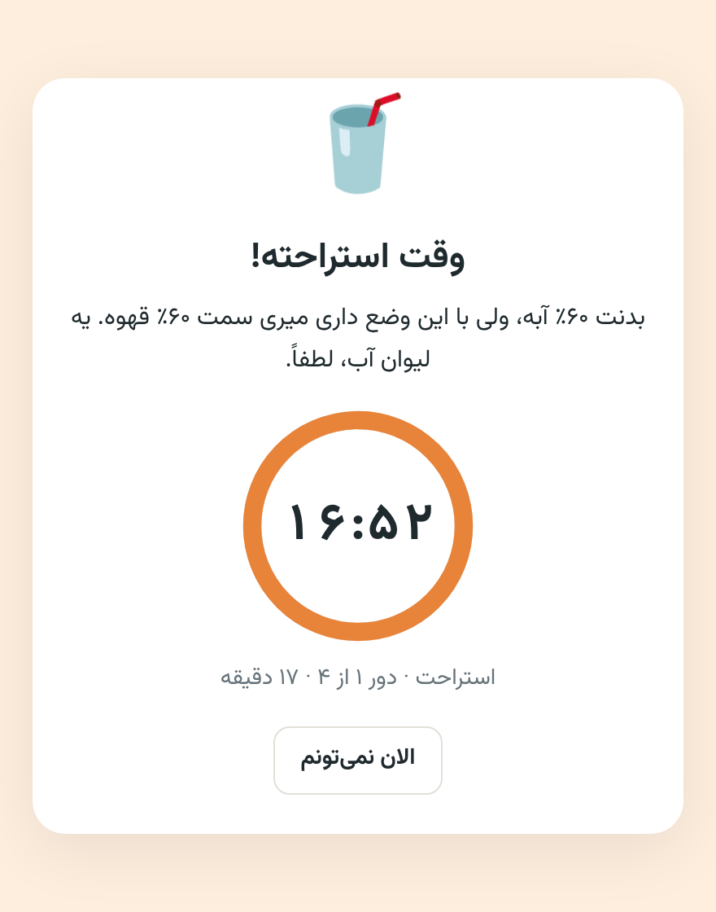

<p align="center"></p>

# نَفَس — استراحت هماهنگ تیمی

افزونه‌ی کروم برای اینکه **همه‌ی اعضای یک تیم با هم و طبق یک قاعده‌ی استاندارد استراحت کنند**. سازنده‌ی گروه مدل را انتخاب می‌کند، اعضا با یک کد ۶ حرفی عضو می‌شوند، و سر وقت استراحت برای همه یک پنجره با تایمر و یک پیام طنز باز می‌شود.

| انتخاب مدل | تایمر گروه | پنجره‌ی استراحت |
|---|---|---|
|  |  |  |

## مدل‌ها (اعداد ثابت و استاندارد، قابل تغییر نیستند)

| مدل | کار | استراحت | مناسب برای |
|---|---|---|---|
| پومودورو | ۲۵ دقیقه | ۵ دقیقه، بعد از هر ۴ دور ۲۰ دقیقه | کارهای خرد، غلبه بر اهمال‌کاری |
| ۵۲/۱۷ | ۵۲ دقیقه | ۱۷ دقیقه | کار دانشی با تمرکز متوسط |
| ریتم اولترادین ۹۰/۲۰ | ۹۰ دقیقه | ۲۰ دقیقه | کار عمیق، کدنویسی، نوشتن |

هر **حلقه** یعنی یک دور کار به‌اضافه‌ی یک استراحت. سازنده تعداد حلقه را بین ۱ تا ۸ انتخاب می‌کند. زمان‌ها فقط در کد (`extension/lib/models.js`) تعریف شده‌اند و سرور فقط شناسه‌ی مدل را قبول می‌کند، پس با دست‌کاری افزونه هم عوض نمی‌شوند.

## امکانات

- ساخت گروه، کد دعوت ۶ حرفی، ساخت کد جدید (اگر کد لو رفت)، حذف عضو
- هر نفر فقط در **یک گروه** است. سازنده نمی‌تواند خارج شود، ولی می‌تواند گروه را حذف کند
- فقط سازنده: انتخاب مدل، شروع، مکث، ادامه، توقف کامل، حذف گروه
- توضیح کامل هر مدل (ترتیب اجرا، مناسب برای، نقطه‌ی قوت و ضعف) قبل از انتخاب
- پنجره‌ی استراحت با شمارش معکوس؛ وقتی تمام شد، پنجره‌ی «برگرد سر کار» و شروع حلقه‌ی بعد
- دکمه‌ی «الان نمی‌تونم» با تأیید طنز: فقط پنجره‌ی همان نفر بسته می‌شود و تایمر گروه ادامه دارد
- بیش از ۷۰ پیام طنز فارسی؛ هر نفر پیام‌ها را به ترتیب تصادفی می‌بیند و تا همه یک بار نیامده‌اند، پیامی تکرار نمی‌شود
- عدد باقی‌مانده روی آیکن افزونه (سبز = کار، نارنجی = استراحت)
- اگر کسی دیر عضو شود یا مرورگرش را دوباره باز کند، خودکار به همان نقطه‌ی بقیه می‌رسد

## ساختار

```
extension/            افزونه‌ی کروم (Manifest V3، بدون build)
  lib/models.js       جدول مدل‌ها و محاسبه‌ی فاز — مشترک با سرور
  lib/messages.js     پیام‌های طنز + shuffle bag
  background.js       همگام‌سازی، alarm هر فاز، باز کردن پنجره‌ی استراحت
  popup/              رابط اصلی
  break/              پنجره‌ی استراحت / برگشت به کار / پایان
server/               Cloudflare Worker + یک Durable Object (SQLite)
server-php/           همان API با PHP 7.4+ و MySQL (برای سرور بیان‌نو)
```

**نحوه‌ی همگام‌سازی:** سرور هر ثانیه چیزی نمی‌فرستد. فقط «برنامه» را نگه می‌دارد (مدل، تعداد حلقه، زمان شروع، زمان مکث). هر افزونه از روی آن و ساعت سرور حساب می‌کند الان کجای چرخه است. افزونه هر ۳۰ ثانیه وضعیت را می‌گیرد (برای مکث/توقف/حذف) و برای پایان هر فاز یک `chrome.alarms` دقیق می‌گذارد.

## دو نسخه‌ی سرور

- **Cloudflare** (`server/`): پایین توضیح داده شده.
- **PHP + MySQL** (`server-php/`): برای میزبانی روی سرور خودتان. راهنمای نصب روی سرور بیان‌نو: [`docs/deploy-bayaneno.md`](docs/deploy-bayaneno.md).

هر دو نسخه یک API دارند و با یک تست سنجیده می‌شوند (`server/test/api.smoke.mjs`). `server-php/test/models-parity.mjs` بررسی می‌کند جدول مدل‌های PHP با `extension/lib/models.js` یکی باشد.

## راه‌اندازی سرور (Cloudflare)

پیش‌نیاز: Node.js 18+ و یک حساب Cloudflare (پلن رایگان کافی است).

```bash
cd server
npm install
npx wrangler login
npx wrangler deploy
```

خروجی یک آدرس `https://nafas-team-break.<account>.workers.dev` می‌دهد.

> ⚠️ دامنه‌های `*.workers.dev` داخل ایران معمولاً فیلتر هستند. یک دامنه یا ساب‌دامنه‌ی خودتان را روی Cloudflare بیاورید و بخش `routes` در `server/wrangler.toml` را باز کنید، مثلاً `nafas-api.example.com`، و دوباره `npx wrangler deploy` بزنید.

## نصب افزونه

1. در کروم به `chrome://extensions` بروید و **Developer mode** را روشن کنید.
2. **Load unpacked** را بزنید و پوشه‌ی `extension/` را انتخاب کنید.
3. آیکن نَفَس را باز کنید و اسمتان را بنویسید.

آدرس سرور فقط در `extension/config.js` تعیین می‌شود و کاربر نمی‌تواند آن را از داخل افزونه تغییر دهد. برای سرور دیگر، همین فایل را عوض کنید و نسخه‌ی تازه پخش کنید.

## تست

```bash
cd server
npm test                       # محاسبه‌ی فازها و مدل‌ها
npm run dev                    # سرور محلی روی 127.0.0.1:8787
node test/api.smoke.mjs        # ۳۲ بررسی API (در ترمینال دیگر)
```

## محدودیت‌ها

- اگر مرورگر بسته یا سیستم در خواب باشد، پنجره‌ای نشان داده نمی‌شود. با باز شدن دوباره، افزونه خودش با گروه هماهنگ می‌شود.
- هویت هر نفر یک شناسه‌ی ناشناس روی همان مرورگر است؛ با عوض‌کردن مرورگر یا دستگاه، عضویت منتقل نمی‌شود.
- تغییرهای سازنده (مکث، توقف) حداکثر با ۳۰ ثانیه تأخیر به اعضا می‌رسد.

فونت: [Vazirmatn](https://github.com/rastikerdar/vazirmatn) (SIL Open Font License).
